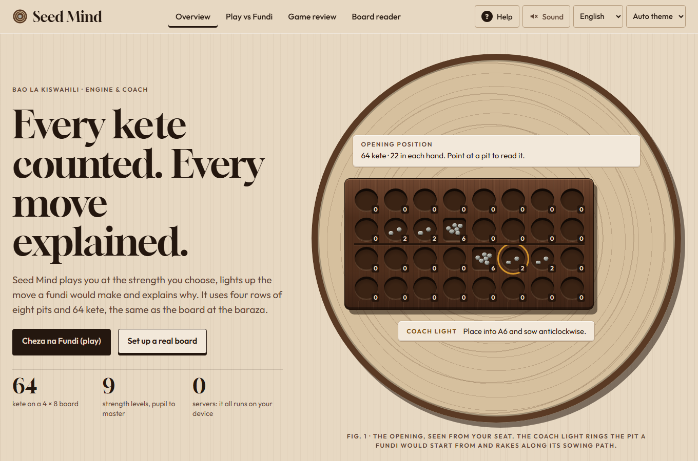
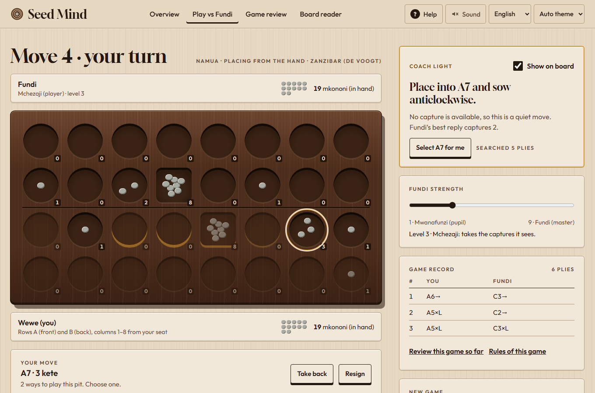
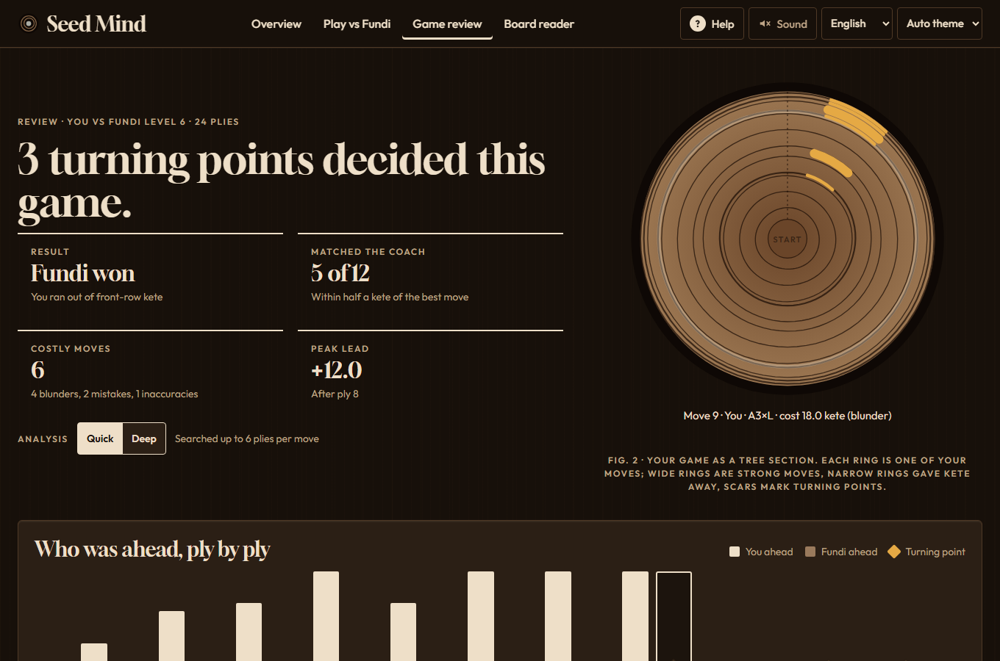
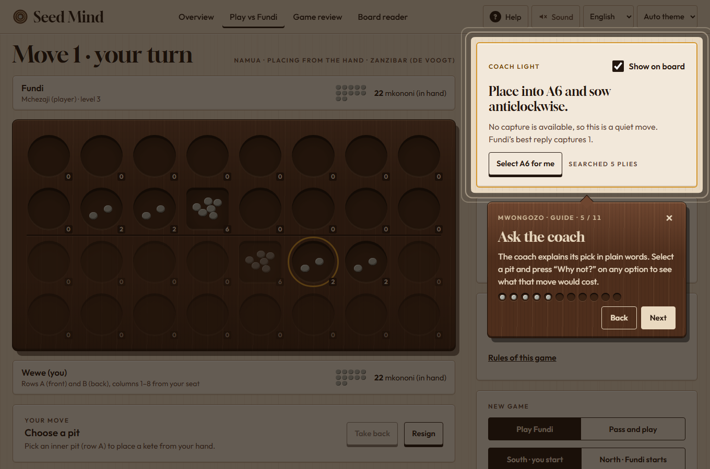
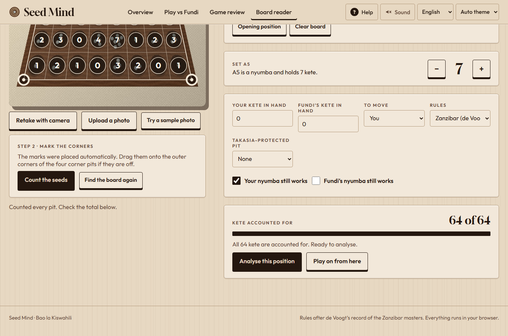

# Seed Mind

Play **Bao la Kiswahili**, the four-row mancala of Zanzibar and the Swahili coast, against an AI
called **Fundi**. A **coach light** rings the move a master would make and explains why. Review
every game as a **tree section of growth rings**, share it as a link, and photograph a real board
to get the position back.

**Live:** https://diorwachira.github.io/seed-mind/ · works offline once loaded · English and
Kiswahili (draft) · no account, no server: everything runs in your browser.



## What it does

| | |
|---|---|
| **Play vs Fundi** | 9 calibrated levels (Mwanafunzi → Fundi), pass-and-play for two people, choice of seat, take back, resign, an optional move clock, seed sounds, and step back through any ply of the record |
| **Coach light** | The best move ringed in ochre with its sowing path, in plain words; **“Why not?”** on any option says what that move would cost in kete |
| **Game review** | Every move scored against the engine (quick or deep). Your game drawn as growth rings, an advantage chart, turning-point cards with the coach's whole line, and export/import as JSON, text notation or a share link |
| **Board reader** | Photograph a real board (or upload one), mark or auto-find its corners, and Seed Mind counts the seeds on your device; unsure pits get a dashed ring |
| **Mwongozo** | An opt-in first-run tour across all four screens, and a help drawer (press `?`) with the rules, a glossary, keys and how it works |
| **Rulesets** | Zanzibar (de Voogt, default), Zanzibar computer rules (Donkers 2003), and the 0.1 simplified rules. See [RULES.md](RULES.md) |

| Play, with “Why not?” | Review as growth rings |
|---|---|
|  |  |
| **The guide (Mwongozo)** | **Board reader** |
|  |  |

## Design: “Growth Rings”

A Bao board is carved from one block of hardwood, so the design draws on two objects: the
carved board with its sunken pits and grey komwe seeds, and the cut section of the tree it came
from. Ochre has exactly one job: the coach light. Fonts are Gloock (display) and Outfit (UI),
self-hosted.

| Reference | What it became |
|---|---|
| Dendrochronology: a wide ring is a good year, a narrow ring a hard one, and a fire leaves a scar ([Reading the Rings, Lady Bird Johnson Wildflower Center](https://www.wildflower.org/magazine/native-plants/reading-the-rings); [Minnesota DNR tree-ring primer](https://files.dnr.state.mn.us/forestry/education/primer/appendixthree.pdf)) | **Game rings**, the Review hero: one ring per move, width = how close to the coach, ochre fire scars on turning points; small versions mark each game in your list. The empty Review is a seedling |
| Carved Zanzibar boards, e.g. the [Smithsonian's bao gameboard](https://www.si.edu/object/gameboard:nmafa_97-10-1) and [Penn Museum's mancala survey](https://penn.museum/sites/expedition/mancala) | The wood slab with sunken pits and a square nyumba, which stays wood in both themes; the guide's tags are carved from the same wood |
| Bao at the baraza in Stone Town ([Africa Geographic](https://africageographic.com/stories/walk-discovery-zanzibars-stone-town/)) | Kiswahili names throughout (kete, mkononi, nyumba, Mwongozo), the “Karibu!” invitation and a Kiswahili UI |
| NN/g on tutorials: pushed walkthroughs don't raise task success and can make apps feel harder ([Mobile tutorials](https://www.nngroup.com/articles/mobile-tutorials/), [Onboarding tutorials](https://www.nngroup.com/articles/onboarding-tutorials/)) | The tour is **opt-in** (shown once, “Not now” is respected), short, and always reachable from Help or `?`. Its progress bar is a row of pits that each get a seed |
| Chess review tools ([Lichess analysis](https://www.mintlify.com/lichess-org/lila/features/analysis)): an eval graph you can click, and mistakes graded by size | The advantage chart jumps to any ply; moves are graded best / fine / inaccuracy / mistake / blunder in kete |
| Donkers' Bao rules and transcript notation ([thesis, appendix C](https://project.dke.maastrichtuniversity.nl/games/files/phd/Donkers_thesis.pdf)) | The `donkers` ruleset, and a published 1994 master game used as a golden test |

## Engine

- Negamax alpha-beta with iterative deepening, Zobrist hashing, a transposition table with
  hash moves, and killer moves, all in Web Workers.
- Evaluation tuned by self-play (`npm run tune`): material plus **kete open to capture**. The
  tuning dropped the hand-written front-row and nyumba bonuses because they lost games.
- **Measured:** the 0.3 engine scores **84% (≈ +288 Elo) over 100 games** against the 0.2 engine
  at 60 ms a move (`npm run match -- 60 50`). Each level scores 5–40% against the level above
  it (`npm run levels`).
- 74 unit tests, including a published master game (Ramadhan v Kijumbe, Zanzibar 1994)
  replayed move for move, and 21 Playwright end-to-end tests with axe accessibility checks.

**Board reader accuracy:** on synthetic photos (perspective, grain, uneven light, noise) the
counter is exact for 96.4% of pits and confidently wrong for only 1.6% (`npm run vision`). Real
photos haven't been measured yet, because no labelled set exists (roadmap Phase 5).

## Run it

```
npm install
npm run dev          # http://localhost:5173
npm test             # unit tests (Vitest)
npm run typecheck
npm run e2e          # Playwright end-to-end tests (builds first)
npm run build        # static site in dist/; BASE_PATH=/repo/ for a sub-path
```

Engine and data tools: `npm run bench` (nodes/s, depth), `npm run match`, `npm run tune`,
`npm run levels`, `npm run vision`, `npm run i18n` (missing Kiswahili strings), `npm run shots`
(screenshots; needs `vite preview` running).

Deploys to GitHub Pages from `main` through `.github/workflows/deploy.yml`, after typecheck,
unit and end-to-end tests pass.

- Rules, sources and the decisions behind them: [RULES.md](RULES.md)
- Status, roadmap and changelog: [roadmap.txt](roadmap.txt)
- How it all works (architecture, internals, recipes, pitfalls): [docs/PROJECT_GUIDE.md](docs/PROJECT_GUIDE.md)
